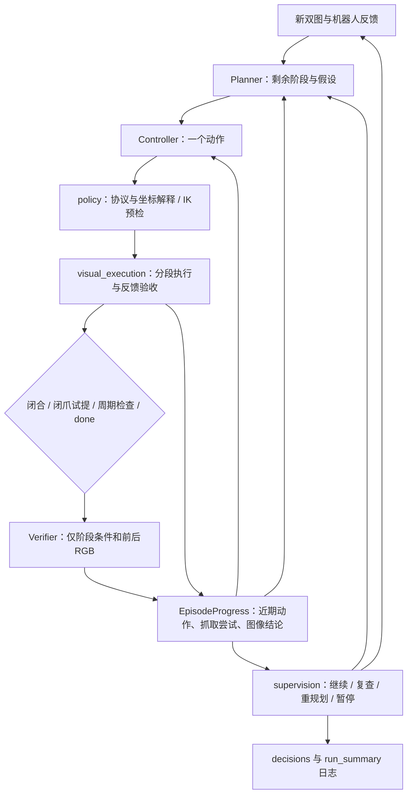

# Robot harness：问题复盘与结构调整

> 历史实现说明：2026-10-28 默认入口已改为 [单 agent 工具工作区](harness_robowork.md)。本文中的阶段预算、纯 RGB 默认和 Planner/Verifier 描述仅对应旧 layered 模式。

核对日期：2026-10-27。依据本地运行日志、实际双视角图片、代码和隔离仿真。这里区分命令执行、图像证据和物理抓取，不能以成功动作数量代替任务成功率。

## 1. 目前到底卡在哪里

| 运行 | 实际记录 | 判断与处理 |
| --- | --- | --- |
| `vision_caa4244d0b` | 27 轮，24 次成功执行；工具 Z 始终约 22.5 cm，最后连续等待 | 动作成功没有带来接近目标；原进程缺少高度提示。高度反馈、等待恢复已补，但不等于解决抓取 |
| `vision_9991983a86` / `vision_43f42cb2cf` | 各 36 轮，均无执行失败、无图像验收；最后工具 Z 分别 14.4 / 11.3 cm | 原 12 轮 × 3 份计划耗尽预算。现已把正常动作复查与停滞预算分开 |
| `vision_fa73f5f575` | 续跑第 37～78 轮，共 42 轮；36 次成功执行、1 次下降跟踪超时、4 次请求重规划、1 次点查询 | 已进入近物体区域；不能再把问题概括成“机械臂不动” |
| 同一续跑 | 第 45/50/57/70/74 轮共 5 次闭合，独立图像验收 **0 次** | `done` 完全由 Controller 决定，Controller 的犹豫使 Verifier 永远不运行。新增事件驱动验收 |
| 同一续跑 | 第 64 轮执行单视角 point | 旧默认工具可读取一个深度像素。新 CLI 默认禁止，必须显式开启 |
| 同一续跑最后图片 | 头图几乎看不到橙碗，腕图能见碗沿但难判断离桌 | 可见性不足有实图依据，不能靠反复“说明抓稳”解决。增加偏侧头部配置，腕部安装不变 |

本地汇总数据：`save/harness_review_20261027.json`。原头图/腕图：`save/harness_review_views/head.png`、`wrist.png`。偏侧效果 `oblique.png` 是**相同记录关节姿态、初始桌面物体布局的离线渲染**，不是还原上次真实物体状态，也不证明已经抓起。

## 2. 结构与职责



| 模块 | 职责 | 不承担的判断 |
| --- | --- | --- |
| `vision.py` | 新鲜观测、模型输入白名单、角色提示组装 | 不读碗真值作为模型观测 |
| `policy.py` | 工具协议、基座/工具坐标变换、IK | 不证明碰撞安全或抓稳 |
| `visual_execution.py` | 预检后按段执行，反馈不符就停止剩余段 | 不把位置到位当作任务完成 |
| `supervision.py` | 纯调度决策和自动验收触发条件 | 不生成恢复运动，不自动开爪 |
| `progress.py` | 最近八条动作、最近四次抓取尝试、最近图像结论 | 不把上提距离当作碗的位移 |
| `continuation.py` | 从显式日志恢复历史，重新观察并规划 | 不重放旧目标，不恢复物体物理状态 |
| `diagnostics.py` | 离线聚合动作/失败/验收/退出原因 | 不调用模型、连接服务或加载图片/API配置 |
| `piper_mujoco_agent.py` | CLI、角色调用与运行生命周期编排 | 不再内嵌全部调度条件和分段执行实现 |

当前是模块化编排，不是经过视觉标注训练的抓取策略；总控脚本仍保留阶段切换、角色调用和停止处理。

## 3. 自动验收如何工作

CLI 默认 `--verification-interval 6`。对 GRASP/LIFT：

1. 闭合执行成功后，获取新图并验收；可恢复超时只有在停止已确认且恢复成功后才允许图像检查。
2. 有闭合尝试记录、实测基座上移至少 5 mm 的动作后，主动检查新图。
3. 闭合期间或 LIFT 阶段，每到指定阶段轮次且本轮为安全执行结果，再检查一次。
4. Controller 仍可用 `done` 请求验收其他阶段。

Verifier 只收到阶段 ID、完成条件、阶段起始双图及新双图；不收到动作结果、工具高度、抓取尝试或 Controller 的自我评价。验收通过才推进阶段；所有剩余阶段通过才完成任务。未通过的理由回到 `last_image_check` 和历史动作，供下一轮判断缺的是包夹、随动还是可见性。未通过不等于“确认空抓”。

动作结果保留 `succeeded/failed`，图像结论单独放在 `verification`。Enter 在验收调用期间生效，迟到结论不推进任务；已经执行的动作仍落盘。停止未确认、结果未知、反馈失效不会被图像结论绕过。

程序化 `run_loop` 为兼容旧调用默认关闭自动验收、保留旧深度工具选项；新调用应明确传 `legacy_actions=False, verification_interval=6, allow_depth_point=False`。CLI 默认就是这个配置。`--verification-interval 0` 可关闭自动触发，但 `done` 仍可验收。

## 4. 输入、记忆和提示词

默认视觉输入是双 RGB + 机器人状态/FK、静态几何参考。单视角 point 在执行解释前被拒绝；只有 `--allow-depth-point` 才开启。双视角对应点三角化仍可用，它会返回由 RGB 对应点与标定推导出的三维点；若任务也禁止这类推导，应避免 point。原始深度图、物体真值和接触信息仍不发送。

`grasp_attempts` 保留最近四次尝试及累计尝试数，记录闭合轮次、重复闭合次数、随后是否发过张开、闭合期间的机械臂位移/累计上移和图像检查。重规划保留它们，选择新物体时重置；它描述的是命令和机器人反馈，张开命令也不证明物体已释放。

提示词分为：

- `common.txt`：共用证据与权限边界。
- `controller.txt`：决策顺序和输出职责。
- `tools.txt`：动作协议、单位、工具轴、传感器开关。
- `grasp.txt`：条件式的观察—对齐—接近—闭合—试提—修正流程。
- `planner.txt`：剩余阶段、跨尝试策略、恢复。
- `verify.txt`：独立图像验收。
- `legacy.txt`：旧低层接口。

Controller 组合 common + controller + tools + grasp。移除了固定“头图向左就是基座 +Y”的提示，改变相机位置后不能沿用这种映射。

## 5. 观察位置与启动

运行配置 `config/runtime/piper_mujoco.yml` 现在选 `head_camera_profile: oblique`：固定相机在基座 `[0.75,-0.65,0.65] m`，看向 `[0.32,0,0.04] m`，垂直视场角 50°。这是声明的固定工作区视角，不按物体真值追踪。腕部仍沿原 RoboTwin URDF 固定关节安装，37°。相机外参和内参随实际渲染更新。

控制器不指定 profile 时仍采用 `robotwin`，保留原资产相机。偏侧视角在记录姿态的离线渲染中能看见桌上橙碗，不能保证所有姿态都无遮挡。

旧 agent 先 Enter 退出。若要应用新头部配置，需要启动一个新场景；重启会重置机械臂和碗：

```bash
cd /Users/niantian/projects/control_your_robot
bash examples/piper_mujoco.sh restart
bash examples/piper_mujoco.sh agent
```

服务尚未启动用 `start` 替代 `restart`。若要保留当前现场，用 `resume`，会启用新的代码/提示和自动验收，但运行中的相机配置不会热更新。

```bash
bash examples/piper_mujoco.sh resume save/vision_fa73f5f575
bash examples/piper_mujoco.sh report --recent 8
```

新日志除了 `turns` 和模型调用，还包括 `decisions.jsonl`、`run_context.json`、`run_summary.json`：可以区分阶段验收、调度原因、启用选项、各预算和最终退出原因。

## 6. 尚未解决的能力缺口

- 位置夹爪在被物体挡住时可能跟踪超时，保持实测宽度不能保证持续夹紧。固定轨迹物理抓取测试有专用持续闭合过程，不能拿它替代 agent 执行器的抓持验收。需要单独设计可取消、限力/限时、带反馈的夹持技能，并用 agent 同一路径测抓取保持。
- 自动验收解决“验收没运行”，不保证模型判断正确。后续应制作包含包夹、空夹、遮挡、离桌的固定 RGB 对照集，分别测 Controller 与 Verifier。
- 当前仍是离散动作，最小 1 cm；没有视觉目标跟踪器、碰撞路径规划或连续视觉伺服。IK 可行并不代表能穿过当前物体。
- 自动检查会增加模型请求。500 是控制轮数上限，Planner/Verifier 另有调用，不能按 500 次 API 调用估算。

本轮没有向在线模型发送请求，也没有把结构回归或离线相机检查宣称为自主抓碗成功。


## 本轮验证记录

完整 harness 回归：355 passed、2 skipped（60.98 s，开启 MuJoCo 渲染；外部 Marvin 资产相关测试跳过）。最终补充的张开命令不得误触发闭爪周期检查，连同自动验收/输入隔离专项再次通过。

隔离服务 `save/supervision_smoke_8e8b6c16af` 使用偏侧头部配置执行空夹和小幅关节动作；调用顺序为 Controller → Verifier → Controller → Verifier，两次位置执行成功、两次脚本化图像结论均为未完成，最终因两轮上限退出。没有在线模型调用；这验证自动验收编排及日志，不评估视觉模型准确率。测试服务已清理。
